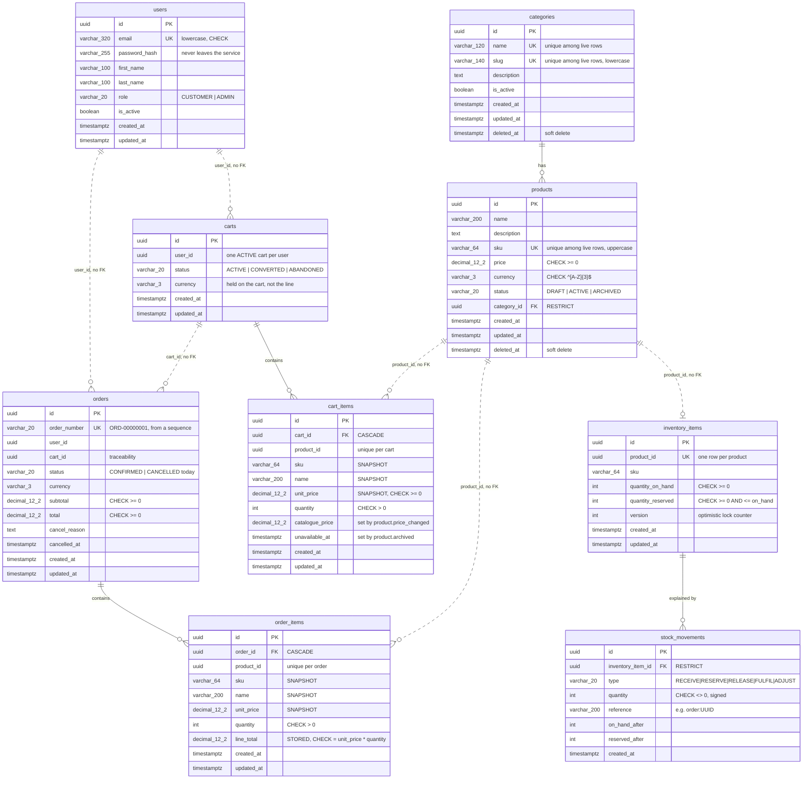

# Database Schema

Every table in the system as of **Milestone 8, step 1**, taken from the
migrations — the migrations are the source of truth, not this file.

**Five databases, one per service.** No service holds credentials for
another's database, so "no service reads another service's tables" is a fact
about the deployment rather than a promise about the code.

```text
ecommerce_auth_db        users
ecommerce_product_db     categories · products
ecommerce_inventory_db   inventory_items · stock_movements
ecommerce_cart_db        carts · cart_items
ecommerce_order_db       orders · order_items
```

---

## The whole picture

Solid lines are real foreign keys. **Dashed lines cross a database boundary
and are therefore NOT foreign keys** — they are UUIDs the application keeps
consistent, because PostgreSQL cannot reference a table in another database.



---

## Per database

### `ecommerce_auth_db`

```text
users
  id                uuid          PK
  email             varchar(320)  UNIQUE · CHECK email = lower(email)
  password_hash     varchar(255)  bcrypt cost 12, excluded by defaultScope
  first_name        varchar(100)
  last_name         varchar(100)
  role              varchar(20)   CHECK IN (CUSTOMER, ADMIN)
  is_active         boolean       default true
  created_at        timestamptz
  updated_at        timestamptz
```

The hash lives behind a Sequelize `defaultScope` that excludes it, so a query
has to ask for it by name (`withPasswordHash`) to see it at all.

### `ecommerce_product_db`

```text
categories                              products
  id           uuid  PK        ┌──────►   id           uuid  PK
  name         varchar(120) U¹ │          name         varchar(200)
  slug         varchar(140) U¹ │          description  text
  description  text            │          sku          varchar(64)  U¹ · CHECK upper
  is_active    boolean         │          price        decimal(12,2) CHECK >= 0
  created_at   timestamptz     │          currency     varchar(3)   CHECK ^[A-Z]{3}$
  updated_at   timestamptz     │          status       varchar(20)  CHECK IN (DRAFT,
  deleted_at   timestamptz ────┘                                     ACTIVE, ARCHIVED)
                     RESTRICT             category_id  uuid  FK ─────┘
                                          created_at   timestamptz
  U¹ = unique among LIVE rows             updated_at   timestamptz
       (WHERE deleted_at IS NULL)         deleted_at   timestamptz
```

Both tables are soft-deleted, and every unique index is **partial** so a
deleted row does not reserve its slug or SKU forever. `RESTRICT`, not
`CASCADE`: deleting a category must not silently take its products with it.

### `ecommerce_inventory_db`

```text
inventory_items                         stock_movements   (append-only ledger)
  id                 uuid PK  ┌──────►    id                 uuid PK
  product_id         uuid  U  │           inventory_item_id  uuid FK ── RESTRICT
  sku                varchar  │           type               varchar(20)
  quantity_on_hand   int      │              RECEIVE · RESERVE · RELEASE
      CHECK >= 0              │              FULFIL  · ADJUST
  quantity_reserved  int      │           quantity           int  CHECK <> 0
      CHECK >= 0              │           reference          varchar(200)
      CHECK <= on_hand ───────┘              e.g. "order:<uuid>"
  version            int                  on_hand_after      int
  created_at         timestamptz          reserved_after     int
  updated_at         timestamptz          created_at         timestamptz
```

**`available` is not a column.** It is `quantity_on_hand − quantity_reserved`,
derived on every read. A stored third number can drift out of agreement with
the other two, and when it does you cannot tell which of the three is wrong.

`quantity_reserved <= quantity_on_hand` is the invariant that makes
overselling structurally impossible rather than merely unlikely.

### `ecommerce_cart_db`

```text
carts                                   cart_items
  id          uuid PK      ┌────────►     id               uuid PK
  user_id     uuid         │              cart_id          uuid FK ── CASCADE
     UNIQUE WHERE          │              product_id       uuid    ─┐ unique
     status = 'ACTIVE' ────┘              sku              varchar   │ together
  status      varchar(20)                 name             varchar  ─┘
     ACTIVE·CONVERTED·ABANDONED           unit_price       decimal(12,2)
  currency    varchar(3)                  quantity         int  CHECK > 0
  created_at  timestamptz                 catalogue_price  decimal(12,2)  NULL
  updated_at  timestamptz                 unavailable_at   timestamptz    NULL
                                          created_at       timestamptz
                                          updated_at       timestamptz
```

`sku`, `name` and `unit_price` are a **snapshot** of the catalogue at
add-time. That duplication is the feature: it is the record of what the
customer was shown, it survives the Product Service being down, and it stops
the total moving while they look at it.

`catalogue_price` and `unavailable_at` are written by the RabbitMQ consumer
when `product.price_changed` or `product.archived` arrives. The snapshot is
never overwritten — the flag only says it is stale.

The partial unique index (one ACTIVE cart per user) is what makes
"get-or-create my cart" safe under two simultaneous first requests.

### `ecommerce_order_db`

```text
order_number_seq  (sequence)            order_items
        │                                 id           uuid PK
        ▼                                 order_id     uuid FK ── CASCADE
orders                    ┌───────────►   product_id   uuid   ─┐ unique
  id            uuid PK   │               sku          varchar │ together
  order_number  varchar   │               name         varchar ─┘
     UNIQUE, default      │               unit_price   decimal(12,2)
     'ORD-' || lpad(...)  │               quantity     int  CHECK > 0
  user_id       uuid      │               line_total   decimal(12,2)
  cart_id       uuid      │                  CHECK = unit_price * quantity
  status        varchar(20)                created_at   timestamptz
     CHECK IN (PENDING, CONFIRMED, PAID,   updated_at   timestamptz
       PROCESSING, SHIPPED, DELIVERED,
       CANCELLED, FAILED)
     only CONFIRMED and CANCELLED are reachable in step 1
  currency      varchar(3)
  subtotal      decimal(12,2)  CHECK >= 0
  total         decimal(12,2)  CHECK >= 0
  cancel_reason text
  cancelled_at  timestamptz
  created_at    timestamptz
  updated_at    timestamptz
```

`line_total` is **stored** here, unlike the cart's, which is derived on every
read. A cart is a working document; an order is a financial record that must
report the same figure in five years even if the arithmetic in this
repository changes. The CHECK stops the frozen value being wrong.

The order number comes from a **sequence**, which is deliberately not
transactional: two concurrent checkouts get 41 and 42 and neither waits. The
cost is gaps; the alternative — `max(order_number) + 1` — needs a table lock
and still races.

---

## Things worth noticing across the whole schema

**Money is `DECIMAL(12,2)`, never `FLOAT`, and crosses the wire as a string.**
A binary double cannot represent 19.99. The pg driver returns NUMERIC as a
string precisely so precision has not already been lost by the time you see
it, and `@ecommerce/money` does the arithmetic in integer minor units.

**The same product data is copied three times** — catalogue → cart line →
order line. Each answers a different question: what it costs _now_, what the
customer _was shown_, what they _agreed to pay_. Normalising that away with a
foreign key would make old orders change value when a price does.

**Nothing is hard-deleted.** Products and categories are soft-deleted; carts
and orders are transitioned, never removed. "There is no row" and "there was
a row and it was cancelled" answer very different questions in a dispute.

**Every cross-database link is a bare UUID.** That is the cost of
database-per-service: referential integrity between services is the
application's job, and there is no constraint to fall back on.

**`FOREIGN KEY` does not create an index in PostgreSQL.** Every FK column
here has one added explicitly — without it, `WHERE category_id = ?` is a
sequential scan and every `DELETE` on the parent scans the whole child table
to enforce RESTRICT.

---

## What step 2 of Milestone 8 adds

Two more tables in `ecommerce_order_db`, and neither describes an order:

```text
order_saga_steps   which step of the checkout workflow ran, and whether it
                   was undone. Answers "did we give the stock back?"

outbox_messages    events waiting to be published, written in the SAME
                   transaction as the order they describe
```

Plus `orders.idempotency_key`, with a partial unique index on
`(user_id, idempotency_key)`, so a retried checkout returns the first order
instead of creating a second.
