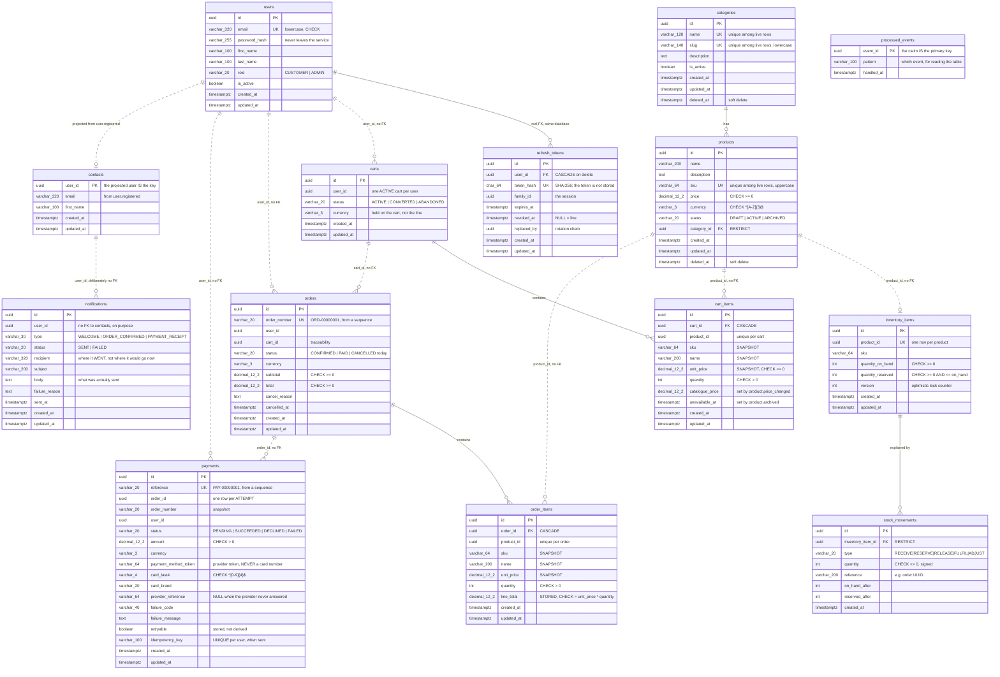

# Database Schema

Every table in the system as of **Milestone 12**, taken from the
migrations — the migrations are the source of truth, not this file.

**Seven databases, one per service.** No service holds credentials for
another's database, so "no service reads another service's tables" is a fact
about the deployment rather than a promise about the code.

```text
ecommerce_auth_db        users · refresh_tokens
ecommerce_product_db     categories · products
ecommerce_inventory_db   inventory_items · stock_movements
ecommerce_cart_db        carts · cart_items
ecommerce_order_db       orders · order_items
ecommerce_payment_db     payments
ecommerce_notification_db  contacts · notifications · processed_events
```

---

## The whole picture

Solid lines are real foreign keys. **Dashed lines cross a database boundary
and are therefore NOT foreign keys** — they are UUIDs the application keeps
consistent, because PostgreSQL cannot reference a table in another database.



---

## Per database

### `ecommerce_auth_db`

```text
users
  id                uuid          PK
  email             varchar(320)  UNIQUE · CHECK email = lower(email)
  password_hash     varchar(255)  bcrypt cost 12, excluded by defaultScope
  first_name        varchar(100)
  last_name         varchar(100)
  role              varchar(20)   CHECK IN (CUSTOMER, ADMIN)
  is_active         boolean       default true
  created_at        timestamptz
  updated_at        timestamptz
```

The hash lives behind a Sequelize `defaultScope` that excludes it, so a query
has to ask for it by name (`withPasswordHash`) to see it at all.

```text
refresh_tokens                     (Milestone 12)
  id                uuid          PK
  user_id           uuid          FK → users.id, ON DELETE CASCADE
  token_hash        char(64)      UNIQUE · SHA-256 hex. The token is NOT stored
  family_id         uuid          the SESSION; rotation keeps it, reuse kills it
  expires_at        timestamptz
  revoked_at        timestamptz   NULL = live
  replaced_by       uuid          the token that superseded this one
  created_at        timestamptz
  updated_at        timestamptz

  indexes: token_hash (unique) · family_id · user_id · expires_at
```

THE TWO COLUMNS WORTH UNDERSTANDING.

`token_hash`, because this table is a list of live credentials. Store the
tokens themselves and a leaked backup — or a support query, or a compromised
read replica — lets someone impersonate every user with an active session for
thirty days, without touching a password. SHA-256 rather than bcrypt is
deliberate: the input is 256 bits of CSPRNG output, so there is no dictionary
to slow down, and a salted hash could not be looked up without scanning the
table.

`family_id`, because rotation alone is not a defence. Every use of a refresh
token retires it and issues a new one carrying the same `family_id`. If an
already-retired token is presented, two parties hold it — and since there is
no way to tell which one is the customer, the whole family is revoked and both
go back to the password.

`revoked_at` is a nullable timestamp rather than a boolean because "when"
answers every question "whether" answers, and an incident is a question about
when.

This is also the table that makes the two token types make sense:

| | access token | refresh token |
| --- | --- | --- |
| Lifetime | ~15 minutes | ~30 days |
| Checked by | signature alone | **this table** |
| Sent | every request | a few times a day |
| Revocable | **no** | yes — one row |

### `ecommerce_product_db`

```text
categories                              products
  id           uuid  PK        ┌──────►   id           uuid  PK
  name         varchar(120) U¹ │          name         varchar(200)
  slug         varchar(140) U¹ │          description  text
  description  text            │          sku          varchar(64)  U¹ · CHECK upper
  is_active    boolean         │          price        decimal(12,2) CHECK >= 0
  created_at   timestamptz     │          currency     varchar(3)   CHECK ^[A-Z]{3}$
  updated_at   timestamptz     │          status       varchar(20)  CHECK IN (DRAFT,
  deleted_at   timestamptz ────┘                                     ACTIVE, ARCHIVED)
                     RESTRICT             category_id  uuid  FK ─────┘
                                          created_at   timestamptz
  U¹ = unique among LIVE rows             updated_at   timestamptz
       (WHERE deleted_at IS NULL)         deleted_at   timestamptz
```

Both tables are soft-deleted, and every unique index is **partial** so a
deleted row does not reserve its slug or SKU forever. `RESTRICT`, not
`CASCADE`: deleting a category must not silently take its products with it.

### `ecommerce_inventory_db`

```text
inventory_items                         stock_movements   (append-only ledger)
  id                 uuid PK  ┌──────►    id                 uuid PK
  product_id         uuid  U  │           inventory_item_id  uuid FK ── RESTRICT
  sku                varchar  │           type               varchar(20)
  quantity_on_hand   int      │              RECEIVE · RESERVE · RELEASE
      CHECK >= 0              │              FULFIL  · ADJUST
  quantity_reserved  int      │           quantity           int  CHECK <> 0
      CHECK >= 0              │           reference          varchar(200)
      CHECK <= on_hand ───────┘              e.g. "order:<uuid>"
  version            int                  on_hand_after      int
  created_at         timestamptz          reserved_after     int
  updated_at         timestamptz          created_at         timestamptz
```

**`available` is not a column.** It is `quantity_on_hand − quantity_reserved`,
derived on every read. A stored third number can drift out of agreement with
the other two, and when it does you cannot tell which of the three is wrong.

`quantity_reserved <= quantity_on_hand` is the invariant that makes
overselling structurally impossible rather than merely unlikely.

### `ecommerce_cart_db`

```text
carts                                   cart_items
  id          uuid PK      ┌────────►     id               uuid PK
  user_id     uuid         │              cart_id          uuid FK ── CASCADE
     UNIQUE WHERE          │              product_id       uuid    ─┐ unique
     status = 'ACTIVE' ────┘              sku              varchar   │ together
  status      varchar(20)                 name             varchar  ─┘
     ACTIVE·CONVERTED·ABANDONED           unit_price       decimal(12,2)
  currency    varchar(3)                  quantity         int  CHECK > 0
  created_at  timestamptz                 catalogue_price  decimal(12,2)  NULL
  updated_at  timestamptz                 unavailable_at   timestamptz    NULL
                                          created_at       timestamptz
                                          updated_at       timestamptz
```

`sku`, `name` and `unit_price` are a **snapshot** of the catalogue at
add-time. That duplication is the feature: it is the record of what the
customer was shown, it survives the Product Service being down, and it stops
the total moving while they look at it.

`catalogue_price` and `unavailable_at` are written by the RabbitMQ consumer
when `product.price_changed` or `product.archived` arrives. The snapshot is
never overwritten — the flag only says it is stale.

The partial unique index (one ACTIVE cart per user) is what makes
"get-or-create my cart" safe under two simultaneous first requests.

### `ecommerce_order_db`

```text
order_number_seq  (sequence)            order_items
        │                                 id           uuid PK
        ▼                                 order_id     uuid FK ── CASCADE
orders                    ┌───────────►   product_id   uuid   ─┐ unique
  id            uuid PK   │               sku          varchar │ together
  order_number  varchar   │               name         varchar ─┘
     UNIQUE, default      │               unit_price   decimal(12,2)
     'ORD-' || lpad(...)  │               quantity     int  CHECK > 0
  user_id       uuid      │               line_total   decimal(12,2)
  cart_id       uuid      │                  CHECK = unit_price * quantity
  status        varchar(20)                created_at   timestamptz
     CHECK IN (PENDING, CONFIRMED, PAID,   updated_at   timestamptz
       PROCESSING, SHIPPED, DELIVERED,
       CANCELLED, FAILED)
     only CONFIRMED and CANCELLED are reachable in step 1
  currency      varchar(3)
  subtotal      decimal(12,2)  CHECK >= 0
  total         decimal(12,2)  CHECK >= 0
  cancel_reason text
  cancelled_at  timestamptz
  created_at    timestamptz
  updated_at    timestamptz
```

`line_total` is **stored** here, unlike the cart's, which is derived on every
read. A cart is a working document; an order is a financial record that must
report the same figure in five years even if the arithmetic in this
repository changes. The CHECK stops the frozen value being wrong.

The order number comes from a **sequence**, which is deliberately not
transactional: two concurrent checkouts get 41 and 42 and neither waits. The
cost is gaps; the alternative — `max(order_number) + 1` — needs a table lock
and still races.

---

### `ecommerce_payment_db`

```text
payment_reference_seq  (sequence)
        │
        ▼
payments                       ONE ROW PER ATTEMPT, not per order
  id                    uuid PK
  reference             varchar(20)  UNIQUE, 'PAY-' || lpad(nextval(...))
  order_id              uuid         ── no FK, another database
  order_number          varchar(20)  snapshot, so a payment reads alone
  user_id               uuid
  status                varchar(20)  CHECK IN (PENDING, SUCCEEDED,
                                               DECLINED, FAILED)
  amount                decimal(12,2)  CHECK > 0
  currency              varchar(3)
  payment_method_token  varchar(64)  the PROVIDER's token for the card
  card_last4            varchar(4)   CHECK ^[0-9]{4}$
  card_brand            varchar(20)
  provider_reference    varchar(64)  NULL when there was no answer at all
  failure_code          varchar(40)
  failure_message       text
  retryable             boolean
  idempotency_key       varchar(100) ─┐ UNIQUE (user_id, idempotency_key)
  created_at            timestamptz   │ WHERE idempotency_key IS NOT NULL
  updated_at            timestamptz  ─┘

  UNIQUE (order_id) WHERE status IN ('PENDING', 'SUCCEEDED')
```

**What this table must never contain**: a card number, a CVV, an expiry date,
a cardholder name. It stores a token the provider issued after its own SDK
collected the card in the customer's browser, plus a last-4 and a brand for
display. A `card_number` column would drag every server, log file, backup and
database dump into PCI scope — and once real card numbers have been written,
they are in the backups.

`card_last4 varchar(4)` with a four-digit CHECK is deliberate belt and
braces: a column that _could_ hold sixteen characters is a column that
eventually will.

**Two indexes, two different problems.** `payments_one_active_per_order`
refuses a second payment while one is in flight or has succeeded — at INSERT
time, before the provider is called, so nothing is charged.
`payments_user_idempotency_key` refuses nothing: it lets the service find the
first attempt and replay its answer, which is what a client that never found
out what happened actually needs.

PENDING is in the first index on purpose. A payment whose outcome is unknown
must block another attempt, because the provider may still be settling it.
The cost is that a stuck PENDING blocks its order until a human intervenes —
the right failure, and the trigger for the reconciliation job.

---

### `ecommerce_notification_db`

```text
contacts                     A PROJECTION, built from user.registered
  user_id     uuid PK        the projected user IS the key
  email       varchar(320)
  first_name  varchar(100)
  created_at  timestamptz
  updated_at  timestamptz

processed_events             what this consumer has already handled
  event_id        uuid PK       claiming is an INSERT that FAILS,
                                not a SELECT that races
  pattern         varchar(100)
  handled_at      timestamptz

notifications                one row per email, sent or not
  id              uuid PK
  user_id         uuid          ── deliberately NO FK to contacts
  type            varchar(30)   CHECK IN (WELCOME, ORDER_CONFIRMED,
                                          PAYMENT_RECEIPT)
  status          varchar(20)   CHECK IN (SENT, FAILED)
  recipient       varchar(320)  where it WENT
  subject         varchar(200)
  body            text          what was actually sent
  failure_reason  text
  sent_at         timestamptz
  created_at      timestamptz
  updated_at      timestamptz
```

**Why this service keeps its own copy of a user.** An order confirmation
needs an email address, and `order.confirmed` carries only a user id —
because the Order Service has only a user id. Calling the Auth Service per
email would put it on the critical path of every receipt; enriching the event
would just move that call into the publisher. So this service listens to
`user.registered` and remembers. That is a **projection**: a small, private
read model built from events, and the standard answer to "a consumer needs
data it does not own".

Its costs are real: the copy goes stale until a `user.updated` event exists,
and a customer who registered before this service did has no row at all —
recorded as a FAILED notification with a reason, never silently skipped.

**No foreign key from `notifications` to `contacts`**, though both live here.
"We emailed this person" is a fact about the past; a CASCADE would delete the
evidence along with the contact. `recipient` is stored per row for the same
reason the cart snapshots a price: the address it went to is a fact, the
contact's current address is not.

**`processed_events` exists here and nowhere else.** Every other consumer in
this system survives at-least-once delivery by being naturally repeatable —
`UPDATE carts SET status='CONVERTED' WHERE status='ACTIVE'` does nothing the
second time. Sending an email cannot be, because there is no WHERE clause
that un-sends one, so this consumer has to recognise the repeat instead.

The primary key is the mechanism: "look it up, and if it is absent do the
work" is check-then-act, and two replicas would both find nothing and both
send. A failed INSERT is atomic; a SELECT is not.

A ledger is not free — a row per event forever, a write on the hot path, and
a retention sweep that does not exist yet. That is exactly why it is not in
the Cart or Order services, where a conditional UPDATE already gives the same
guarantee for nothing.

---

## Things worth noticing across the whole schema

**Money is `DECIMAL(12,2)`, never `FLOAT`, and crosses the wire as a string.**
A binary double cannot represent 19.99. The pg driver returns NUMERIC as a
string precisely so precision has not already been lost by the time you see
it, and `@ecommerce/money` does the arithmetic in integer minor units.

**The same product data is copied three times** — catalogue → cart line →
order line. Each answers a different question: what it costs _now_, what the
customer _was shown_, what they _agreed to pay_. Normalising that away with a
foreign key would make old orders change value when a price does.

**Nothing is hard-deleted.** Products and categories are soft-deleted; carts
and orders are transitioned, never removed. "There is no row" and "there was
a row and it was cancelled" answer very different questions in a dispute.

**Every cross-database link is a bare UUID.** That is the cost of
database-per-service: referential integrity between services is the
application's job, and there is no constraint to fall back on.

**`FOREIGN KEY` does not create an index in PostgreSQL.** Every FK column
here has one added explicitly — without it, `WHERE category_id = ?` is a
sequential scan and every `DELETE` on the parent scans the whole child table
to enforce RESTRICT.

---

## Still to come

Milestones 11 and 12 added exactly one table between them — `refresh_tokens`
above. Observability added none: a correlation id travels on requests and
events, not in a table, and health checks and the exception filter are
behaviour rather than data.

Nothing scheduled adds a table either. The DLQ parking queue (pass 4) lives
in the broker, not in PostgreSQL, which is the point of it — a message that
cannot be processed should not become a row somebody has to remember to look
at.
